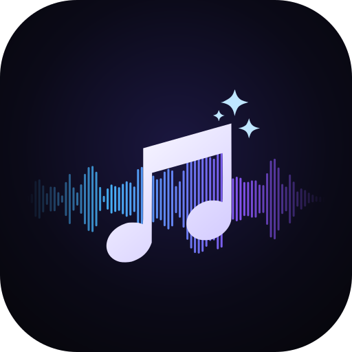

<p align="center">
  
</p>

<h1 align="center">Rash Music</h1>

<p align="center">A fast, smooth music player for Android.<br/>Developer: <b>AHR</b> · <a href="https://t.me/+-Bo6KSNJWf9iNjQ">Telegram</a></p>

## Download

Grab the latest signed APK from the **Releases** page of this repository. Sideloading needs "Install unknown apps" enabled for the app you download it with. New versions show up as an update popup inside the app.

## Build

```
./gradlew assembleProdRelease
```

Release signing uses the `KEYSTORE_BASE64`, `KEYSTORE_PASSWORD`, `KEY_ALIAS` and `KEY_PASSWORD` repository secrets (see `.github/workflows/android.yml`). To ship an update, bump `rashmusicVersionCode` and `rashmusicVersionName` in `build.gradle.kts` and push to `main`.

## License

GPL-3.0 — see [LICENSE](LICENSE). Rash Music is built on the open-source BitChord project; its copyright notices are kept in the source files as the license requires.
